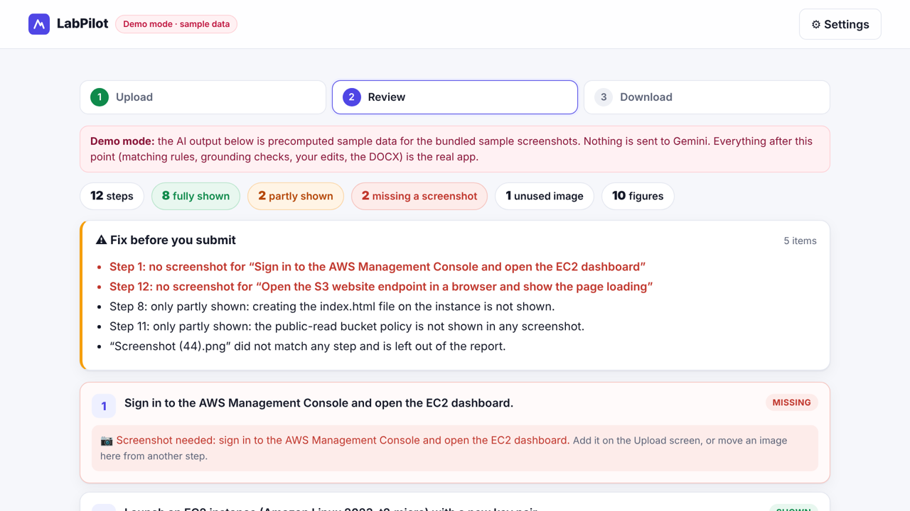

# LabPilot

**Screenshots in, submission-ready lab report out.**

You upload a lab assignment and your screenshots, in any order. LabPilot reads each screenshot with Gemini vision and puts it under the step it proves. It flags steps that have no proof (*"Step 12: no screenshot for 'Open the S3 website endpoint…'"*) and writes a short explanation for each step using only what the screenshots show. Then you download a formatted DOCX with your details table, numbered figures with captions, and a page listing what's still missing.

**▶ Live demo:** `https://armstrong24.github.io/labpilot/` *(placeholder until GitHub Pages is enabled)*. Click **Try the demo**: it needs no key.
**🎬 Video:** *(add the link after uploading)*



---

## The problem

I'm a second-year AI & Data Science student. Most weeks I have a lab where I follow a checklist and screenshot every step: launch an EC2 instance, open ports 22 and 80, SSH in, install Apache, create an S3 bucket, enable static hosting, and so on. Then comes the part nobody teaches.

- I end up with 20 files called `Screenshot (47).png` and `WhatsApp Image … .png`, in random order.
- I have to work out which screenshot proves which step.
- I only notice the screenshot I forgot after the AWS resources are deleted.
- I have to write an explanation, captions, theory and a conclusion in Word, then fix the formatting.

I did exactly this by hand for my cloud computing lab and it took longer than the lab itself. LabPilot automates the boring half. It refuses to invent the half that has to be true.

## Features

- **Any input format.** Paste the assignment text, or upload a DOCX (read with mammoth) or PDF (read with pdf.js). Numbered steps are parsed locally. If the text has no numbering, Gemini splits it into steps.
- **Screenshots in any order.** PNG, JPG and WebP all work. Images are resized in the browser to 1600 px or less before upload.
- **Automatic matching.** Every screenshot goes to its step, with a confidence score. Low-confidence matches are flagged.
- **Missing-evidence detection.** Steps with no screenshot, and steps a screenshot only partly shows ("bucket policy not visible"), are listed up front and in the report.
- **Grounded explanations.** Each explanation cites exact quotes from the screenshot's transcribed text, and LabPilot checks every quote client-side. If a quote isn't in the transcription, the claim is flagged and the text falls back to a literal description of the screenshot.
- **You stay in control.** Move any screenshot to another step, or mark it "not used". You can edit every explanation, the theory and the conclusion. The warnings update live.
- **One-click DOCX.** The report has a title, a student details table, aim, theory, procedure with numbered figures and captions, conclusion, an optional "Missing Evidence and Review Notes" page, and page numbers. It is generated entirely in the browser.
- **Demo Mode.** A bundled sample AWS EC2 + S3 lab with 11 labelled sample screenshots. Two steps are deliberately missing, two are partial, and one image is unrelated. It runs the whole flow without a key.
- **Mobile-friendly.** The 3-step flow works on a phone.

## How it works

```
assignment (txt/docx/pdf) ──► parseChecklist() ──► steps S1..Sn
screenshots ──► resize in browser ──► Stage 1: Gemini vision, 5 images per call
                                        "transcribe only what is visible" ──► observations (JSON schema)
steps + observations ──► Stage 2: Gemini text-only
                           match images→steps, write explanations with evidence quotes ──► analysis (JSON schema)
analysis ──► buildModel(): grounding gate + rules ──► review UI (edit / move) ──► docx ──► .docx download
```

1. **Stage 1 (see).** Gemini receives the screenshots in batches and returns, for each one, its verbatim visible text, a literal summary, key values and whether it is legible. It is told never to guess cropped or blurred values.
2. **Stage 2 (write).** A second, text-only call gets the checklist and the observations, but never the images. So the writer can only use what the reader transcribed. It returns one match per image, one write-up per step (coverage `full`/`partial`/`none`, explanation, evidence quotes, gap), plus theory and a conclusion.
3. **Grounding gate (`js/core.js` `buildModel`).** This runs locally and deterministically:
   - It drops unknown image and step ids, keeps one match per image, and applies your manual moves.
   - A step with no screenshot always gets coverage `none` and an empty explanation, plus a *missing* warning, even if the model claimed otherwise.
   - Every evidence quote must appear in the transcription of an image assigned to that step. If one doesn't, the step is flagged *check the explanation*. If a step has no verified quote at all, its text is replaced with the transcription summary.
   - Low-confidence matches, illegible images and unused images become review notes.

Both model calls use **structured output with a JSON Schema**. They retry with exponential backoff on network errors, 408/429/5xx and unparseable JSON (Retry-After is honoured), and fail fast with a readable message on 400/401/403/404, such as a bad key or an unknown model.

## Setup

LabPilot is static files with no build step.

```bash
git clone https://github.com/Armstrong24/labpilot && cd labpilot
python3 -m http.server 8765       # or any static server
# open http://localhost:8765  →  "Try the demo"
```

To run it live, open **⚙ Settings**, paste a Gemini API key from [Google AI Studio](https://aistudio.google.com/apikey), pick a model, and click **Analyze with Gemini**.

| Setting | Default | Notes |
|---|---|---|
| Model | `gemini-3.8-flash` | Also `gemini-3.5-flash-lite`, `gemini-3.6-flash`, `gemini-4-argon` and `gemini-flash-latest`, or type any model id. Names checked against Google's model list on 22 Oct 2026. |
| API | Interactions API | `POST https://generativelanguage.googleapis.com/v1beta/interactions` with `response_format` (JSON schema) and `store: false`. The legacy `models/{model}:generateContent` with `responseJsonSchema` is available as a fallback. |

**Deploy to GitHub Pages:** push the repo, then go to Settings → Pages → *Deploy from a branch* → `main` / root. The `.nojekyll` file is included. All libraries are vendored in `vendor/` at pinned versions (docx 9.13.0, mammoth 1.13.0, pdfjs-dist 6.4.299), so no CDN is needed at runtime.

## Tests

```bash
npm test                 # = node --test tests/labpilot.test.cjs   (no npm install needed)
python3 -m http.server 8765 & python3 tests/e2e_browser.py   # needs playwright + a Chromium
```

- **21 unit tests:**
  - Checklist parsing: numbered, "Step N:" style, bullets, wrapped lines, duplicate numbers.
  - The demo model: exactly steps 1 and 12 missing, 8 and 11 partial, 1 unused image.
  - The grounding gate: an invented IP is rejected and the text falls back, cross-step evidence is rejected, and false coverage is overridden.
  - Id normalisation, manual moves, edits and fuzzy quote matching.
  - The report outline, plus a real `.docx` packed with 10 embedded images.
  - The REST request shapes for both APIs, response parsing, and retry/no-retry behaviour with a fake `fetch`.
- **27 headless-browser checks** in real Chromium:
  - The demo flow, including a move, an edit, the preview and a DOCX download.
  - The **live flow** with Gemini responses intercepted, run twice (once with a PDF checklist, once with a DOCX checklist). This checks real file uploads, a first-call 503 that triggers a retry, 3 vision batches plus 1 analysis call, `store=false`, the JSON schema and inline base64 images.
  - A bad-key error message, and no horizontal overflow at 390 px wide.

## Privacy

- Your API key is kept in `sessionStorage` only. It is cleared when the tab closes, and you can remove it sooner with **Forget key**. It is sent only to `generativelanguage.googleapis.com`.
- There is no LabPilot server, database or analytics. Screenshots and the assignment go straight from your browser to Google's Gemini API and nowhere else.
- Interactions API calls set `store: false`, so the interaction is not saved for later retrieval. Google's own [API terms and data-use policy](https://ai.google.dev/gemini-api/terms) still apply to your key; free-tier keys may be used to improve Google's products.
- The DOCX is built locally. Demo Mode makes no network calls beyond loading its own sample files.

## Tech stack

Vanilla HTML, CSS and JavaScript, with no framework and no build step:

- [docx](https://github.com/dolanmiu/docx) builds the report.
- [mammoth](https://github.com/mwilliamson/mammoth.js) reads DOCX input.
- [pdf.js](https://github.com/mozilla/pdf.js) reads PDF input.
- The Google Gemini API, over REST, does the vision and writing.

Tests use `node:test` and Playwright. The demo screenshots are generated by `tools/make_demo_screens.py` (Pillow).

```
index.html  styles.css
js/core.js     parsing, schemas, prompts, grounding gate, report model   (pure, tested in Node)
js/gemini.js   REST client: two transports, retries, batching
js/report.js   report outline + DOCX renderer
js/ingest.js   DOCX/PDF text extraction, image resizing
js/app.js      UI
demo/          sample checklist, 11 SAMPLE screenshots, precomputed sample AI output
tests/         unit tests, headless e2e, fixtures (checklist.pdf / .docx)
```

## How it fits the judging criteria

| Criterion | How LabPilot answers it |
|---|---|
| **Innovation / Creativity** | It isn't another chat-with-your-PDF. It audits evidence. A two-stage *see, then write* pipeline means the writer never sees pixels, only the transcript. A deterministic gate then checks every quoted claim, and missing evidence is a first-class output rather than a failure. |
| **Technical execution** | A static app with no backend. Structured JSON output with schemas, batching, retries with backoff and readable errors. Two documented Gemini transports. DOCX built client-side with real figures. 21 unit tests and 27 real-browser checks. |
| **Impact / Usefulness** | Every engineering student writes lab reports weekly. It saves hours, and it catches the forgotten screenshot while you can still retake it, before the AWS resources are torn down. Teachers get reports where every claim points to a figure. |
| **Completeness / Functionality** | The full flow works end to end: upload, AI analysis, review and edit, DOCX download. A one-click Demo Mode needs no key. It is mobile-friendly and deploys to GitHub Pages. A sample report is in `docs/sample-report.docx`. |

## Honest limits

- Demo Mode's AI output is **precomputed sample data**, hand-written in the exact schema the live pipeline returns. It is not a recording of a live Gemini call.
- LabPilot checks that cited text appears in the transcription. It cannot prove the transcription itself is perfect, so read the report before you submit it.
- The theory section is general background. It is not checked against screenshots.
- It is built for screenshot-based labs (cloud, Linux, networking, DBMS, programming output). Handwritten or circuit labs are out of scope for now.

## Academic integrity

LabPilot organises and describes **your own** work. It never fabricates outputs, and it tells you what you still need to capture. Check your course's policy on AI assistance and disclose it if required.

---

Built by **Arnav Kale** (GitHub [@Armstrong24](https://github.com/Armstrong24)), SY B.Tech AI & Data Science, Vishwakarma University, Pune, for DevSpot Build Mode (Wildcard Challenge). MIT licensed.
